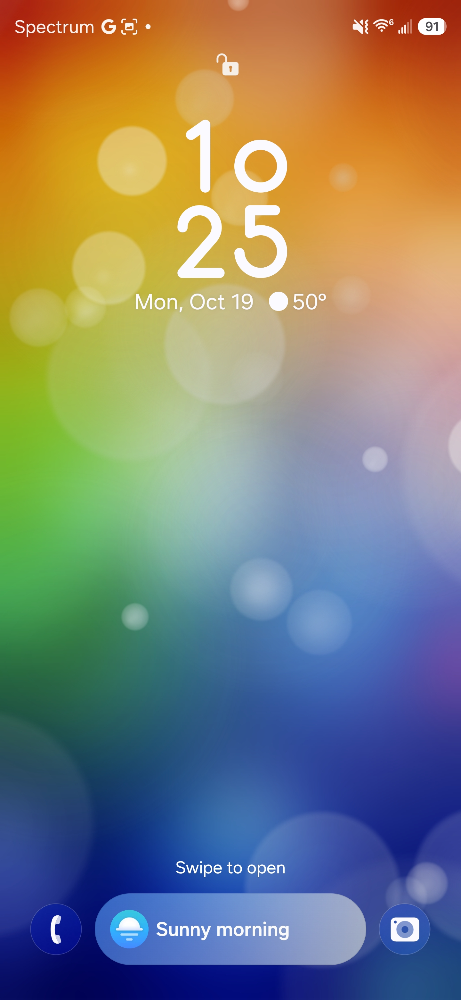
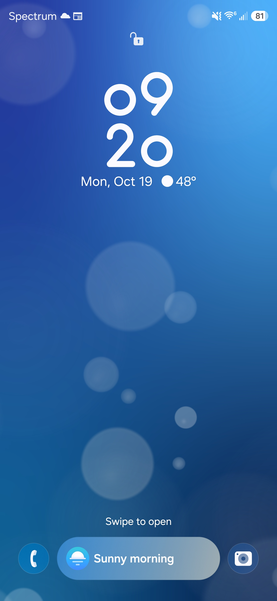
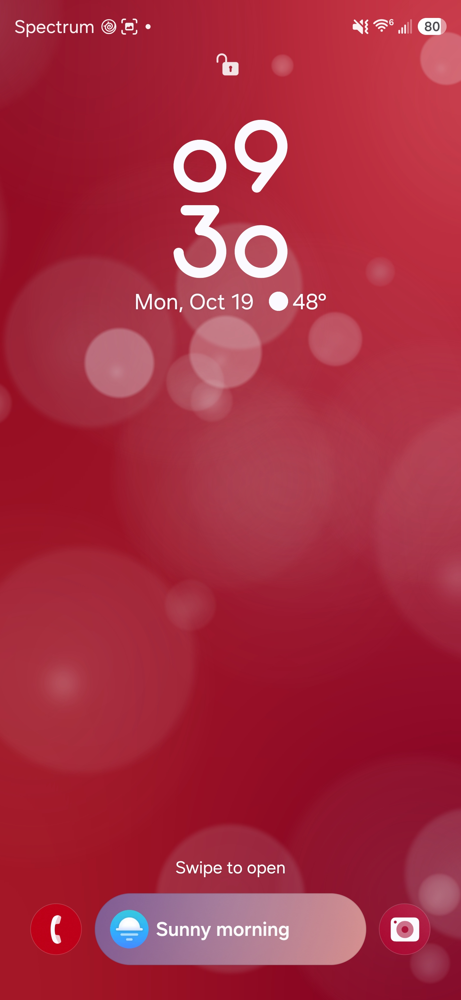

# HTC Sense Bokeh Live Wallpaper (Android)

**Live wallpaper** inspired by HTC Sense **Bokeh** (Mode10). Rewritten in Java/OpenGL for **64-bit** phones where the original 32-bit native wallpaper cannot run.

> **Not affiliated with HTC.** Same aesthetic goal; new implementation.

**Related:** [HTC Weather Flip Clock](https://github.com/neptaligonzalez7-afk/htc-weather-flip-clock) — Sense-style home-screen widget with Open-Meteo weather.

## Screenshots

| Rainbow (archive) | Ocean blue | Crimson red |
|-------------------|------------|-------------|
|  |  |  |

Lock screen / home screen may show your clock and weather widgets; the wallpaper is the bokeh gradient behind them.

## Download

Get builds from **[Releases](https://github.com/neptaligonzalez7-afk/htc-sense-live-wallpaper/releases)**.

All variants share package **`com.htc.android.wallpaper`**. Only **one** APK can be installed at a time (installing another **replaces** the app).

| Variant | File | versionCode | versionName | Description |
|---------|------|-------------|-------------|-------------|
| **Rainbow (archive)** | `HTC-Sense-LiveWallpaper-android36.apk` | **54** | `1.00-android36` | Original Sense rainbow / thumbnail look; reference build |
| **Ocean blue** | `HTC-Sense-LiveWallpaper-ocean-blue.apk` | **70** | `1.01-ocean-blue` | Smooth blue gradient; depth-of-field bubbles |
| **Crimson red** | `HTC-Sense-LiveWallpaper-crimson.apk` | **69** | `1.02-crimson` | Red gradient with lighter highlight (top-right) |

**Naming:** each release attaches the APK filename above (or `-v<TAG>` suffix if we ship multiple builds of the same variant). Pick **Releases → Latest** for the recommended blue build unless you want crimson or the archive.

## Requirements

- Android **7.0+** (API 24), **targetSdk 36**
- **Live wallpaper** support (standard on Samsung One UI and most launchers)

## Install

1. Download a variant from **Releases**.
2. Allow **Install unknown apps** for your browser or Files app if prompted.
3. Install the APK.
4. **Wallpapers** → **Live wallpapers** → **HTC Sense** (or your launcher’s wallpaper picker).
5. After an upgrade, if the look does not update, pick another wallpaper briefly, then select **HTC Sense** again.

Developers:

```bash
adb install -r HTC-Sense-LiveWallpaper-ocean-blue.apk
```

**Downgrades:** Android may block installing an older **versionCode** over a newer one (e.g. crimson **69** over ocean **70**). Uninstall the live wallpaper app first, or install the build with the higher **versionCode**.

## Variants explained

- **Rainbow / android36** — Classic multi-color Sense look from the original thumbnail; preserved reference build (v54).
- **Ocean blue** — Royal/azure gradient (smooth shader background, no banding).
- **Crimson** — Same bubble field and focus behavior; red tones with a stronger light side.

Bubbles are white/translucent; color comes from the background. Some medium/large orbs use a sharper “in focus” rim for depth.

## Troubleshooting

| Symptom | What to try |
|---------|-------------|
| Black or frozen wallpaper | Re-select **HTC Sense** in the picker; reboot once. |
| Still shows old colors after install | Uninstall → reinstall → pick wallpaper again. |
| “App not installed” | Uninstall any existing **`com.htc.android.wallpaper`** build, then retry. |
| Won’t install over another variant | Same package — uninstall first, or use the higher **versionCode** build. |

## Signing

APKs are **debug-signed** for sideloading. They are not Play Store builds.

## License

See [LICENSE](./LICENSE). HTC Sense names and assets are trademarks of their respective owners.

## Reporting issues

Open a **GitHub Issue** with device model, **Android version**, launcher name, **APK filename**, and a short screen recording of the wallpaper (home + lock screen if relevant).

---

**Support (optional)** — [Buy me a coffee](https://buymeacoffee.com/neta4457).
